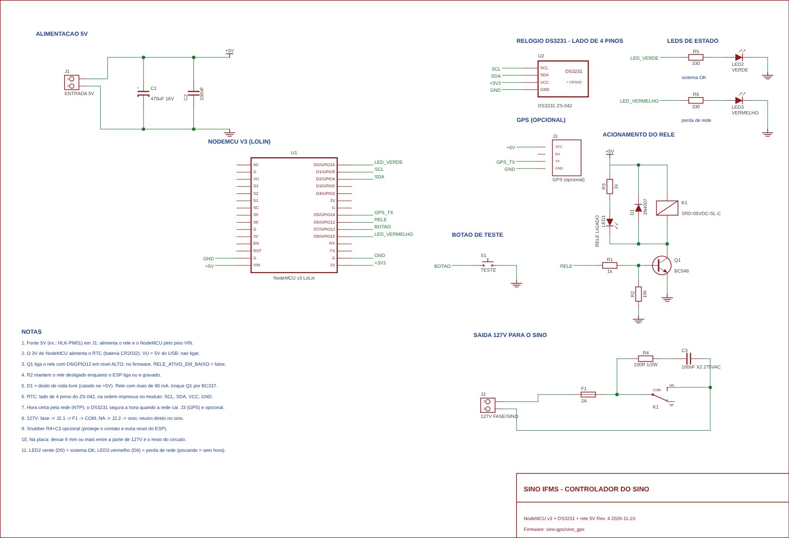
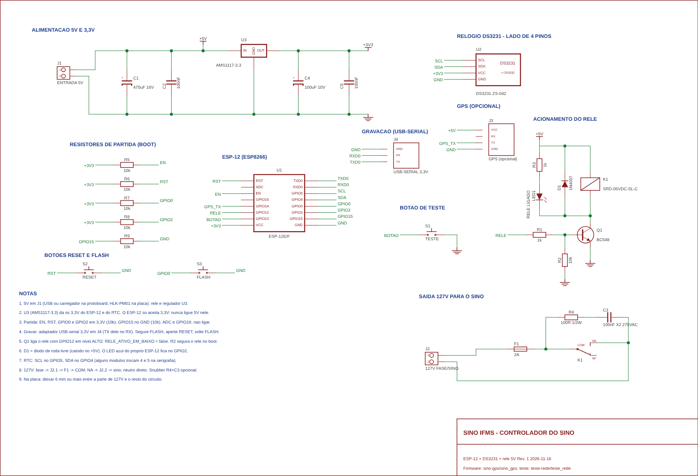

# Esquema eletrônico do sino (Eagle)

Há dois esquemas, um para cada jeito de montar o ESP-12:

| Versão | Esquema (Eagle) | Prévia | Protoboard |
|---|---|---|---|
| **NodeMCU v3 LoLin** (ESP-12 numa placa com USB) | `Sino_IFMS_v2.sch` | [`esquema.png`](esquema.png) | [`PROTOBOARD.md`](PROTOBOARD.md) |
| **ESP-12 avulso** (com regulador de 3,3 V, resistores de partida, botões RESET/FLASH e conector de gravação) | `Sino_IFMS_ESP12.sch` | [`esquema_esp12.png`](esquema_esp12.png) | [`PROTOBOARD_ESP12.md`](PROTOBOARD_ESP12.md) |

Nos dois, o relé, o relógio, o botão de teste e a saída de 127 V são iguais e
usam os mesmos GPIOs, então o mesmo firmware serve para os dois.

| Arquivo | O que é |
|---|---|
| `Sino_IFMS_v2.sch`, `Sino_IFMS_ESP12.sch` | esquemas para o **Eagle** (7.7 ou mais novo). A biblioteca das peças vai junto, dentro de cada arquivo |
| `esquema.png`/`.svg`, `esquema_esp12.png`/`.svg` | prévias dos esquemas |
| `gerar_esquema.py` | script que gera os arquivos acima (`python3 gerar_esquema.py`) |
| [`PROTOBOARD.md`](PROTOBOARD.md), [`PROTOBOARD_ESP12.md`](PROTOBOARD_ESP12.md) | **montagem e roteiro de teste na protoboard** (faça antes da placa) |

Para abrir: copie `Sino_IFMS_v2.sch` para a pasta do projeto no Eagle
(`Documentos\EAGLE\Sino_IFMS`) e abra pelo Eagle. O nome tem `_v2` de propósito,
para não sobrescrever o esquema que já existe lá. Para desenhar a placa, use
**Board** (ou "Switch to board"): o Eagle cria o `.brd` com todas as peças.

## O circuito

| Bloco | Como funciona |
|---|---|
| **Alimentação** | Uma fonte de 5 V (ex.: HLK-PM01) entra por **J1**. C1 (470 µF) e C2 (100 nF) seguram os picos do Wi-Fi e do relé. Os 5 V alimentam o **relé** e o **NodeMCU pelo pino VIN** |
| **NodeMCU v3 LoLin (U1)** | ESP-12E com USB e regulador de 3,3 V. Pega a hora pela rede (NTP). O **3V do NodeMCU alimenta o relógio**. O pino VU (5 V do USB) fica sem ligar |
| **Relógio (U2)** | Módulo DS3231 ZS-042 ligado pelo **lado de 4 pinos** (SCL, SDA, VCC, GND, conferido na foto do módulo), com bateria CR2032. Segura a hora quando a rede cai |
| **Relé (K1)** | Relé 5 V acionado por **Q1 (BC548)**. R1 (1 kΩ) na base, **R2 (10 kΩ)** segura o relé desligado enquanto o ESP liga ou é gravado, **D1 (1N4007) é o diodo de roda livre**. LED1 + R3 acendem quando o relé liga |
| **Saída 127 V** | Fase entra em **J2.1**, passa pelo **fusível F1** e vai ao **COM** do relé; o **NA** volta por **J2.2** para o sino. O neutro vai direto ao sino. R4 + C3 (snubber, opcional) protegem o contato |
| **Botão S1** | Toque de teste na mão |
| **J3 (opcional)** | Conector para o GPS GY-NEO6MV2, na mesma ordem dos pinos do módulo (VCC, RX, TX, GND) |

### Pinos do NodeMCU

| Pino | GPIO | Ligado em | No firmware (`config.h`) |
|---|---|---|---|
| D1 | 5 | SCL do DS3231 | `PINO_SCL` |
| D2 | 4 | SDA do DS3231 | `PINO_SDA` |
| D4 | 2 | LED azul do próprio NodeMCU | `PINO_LED` |
| D5 | 14 | TX do GPS (opcional) | `PINO_GPS_RX` |
| D6 | 12 | R1 → base do BC548 (relé) | `PINO_RELE` |
| D7 | 13 | botão de teste S1 (até o GND) | `PINO_BOTAO_TESTE` |
| VIN | – | +5 V da fonte | – |
| 3V | – | VCC do DS3231 | – |
| G | – | GND | – |

> **Importante no firmware:** com o BC548 o relé liga quando D6 vai a 3,3 V,
> então `RELE_ATIVO_EM_BAIXO` tem que ser **`false`** (já está assim no
> `config.h`). Se ficar `true`, o sino toca sem parar.

## Versão com ESP-12 avulso

O que muda em relação ao NodeMCU:

| Bloco | Como funciona |
|---|---|
| **U3 (AMS1117-3.3)** | tira 3,3 V dos 5 V da fonte para o ESP-12 e o relógio. C4 (100 µF) e C5 (100 nF) seguram os picos do Wi-Fi |
| **R5 a R9 (10 kΩ)** | partida do ESP-12: EN, RST, GPIO0 e GPIO2 em 3,3 V; GPIO15 no GND |
| **S2 (RESET) e S3 (FLASH)** | para gravar: segure FLASH, aperte RESET, solte FLASH |
| **J4** | adaptador USB-serial de 3,3 V: GND, RX e TX do ESP (TX do adaptador no RX do ESP) |

Peças a mais na lista de material: ESP-12E/F (em vez do NodeMCU), AMS1117-3.3
(SOT-223), capacitor eletrolítico 100 µF 10 V, capacitor cerâmico 100 nF,
5 resistores de 10 kΩ, 2 botões táteis e uma barra de 3 pinos. O desenho do
ESP-12 na placa tem medidas aproximadas: confira no datasheet antes de furar.

## Gerenciamento local

- **Gravar o firmware:** pelo USB do NodeMCU (os botões RST e FLASH já estão
  na placa do NodeMCU). Na Arduino IDE, placa **NodeMCU 1.0 (ESP-12E Module)**.
  Para gravar, prefira desligar a fonte de 5 V. Muitos NodeMCU têm um diodo
  entre o USB e o VIN, mas nem todo clone tem.
- **Mudar horários e senhas sem internet:** pela rede Wi-Fi do próprio sino
  (nome oculto), em `http://192.168.4.1`. Veja `../sino-gps/README.md`.
- **Pela rede da instituição:** quando o MAC estiver cadastrado, a mesma página
  abre pelo IP do sino nessa rede.

## Lista de material

| Ref. | Peça | Qtd. |
|---|---|---|
| U1 | NodeMCU v3 LoLin (ESP-12E) | 1 |
| U2 | Módulo RTC DS3231 ZS-042 + bateria CR2032 | 1 |
| K1 | Relé 5 V SRD-05VDC-SL-C (Songle) | 1 |
| Q1 | Transistor BC548 (ou BC337, mesma pinagem) | 1 |
| D1 | Diodo 1N4007 | 1 |
| LED1 | LED 3 mm vermelho | 1 |
| R1, R3 | Resistor 1 kΩ 1/4 W | 2 |
| R2 | Resistor 10 kΩ 1/4 W | 1 |
| R4 | Resistor 100 Ω 1/2 W (snubber, opcional) | 1 |
| C1 | Capacitor eletrolítico 470 µF 16 V | 1 |
| C2 | Capacitor cerâmico 100 nF | 1 |
| C3 | Capacitor de poliéster 100 nF **classe X2 275 VAC** (snubber, opcional) | 1 |
| F1 | Fusível 5x20 mm 2 A + porta-fusível de placa (ajuste à corrente do seu sino) | 1 |
| J1, J2 | Borne de parafuso 2 vias, passo 5,08 mm | 2 |
| J3 | Barra de pinos 1x4 (GPS, opcional) | 1 |
| S1 | Botão táctil 6x6 mm | 1 |
| – | Fonte 5 V (ex.: HLK-PM01, 127 V → 5 V 600 mA) | 1 |

## Notas para quando for fazer a placa

- **RTC:** a ordem dos 4 pinos do ZS-042 (SCL, SDA, VCC, GND) foi conferida
  na foto do módulo.
- **NodeMCU:** o desenho usa o v3 LoLin (fileiras a 27,94 mm, placa de
  31 x 58 mm). O contorno é aproximado: confira com a placa antes de furar.
  Barras fêmea de 15 pinos deixam o NodeMCU removível.
- **Relé:** o desenho usa as medidas do SRD (pinos 1 = COM, 3 = NA, 4 = NF,
  2 e 5 = bobina). A corrente da bobina é de uns 70 mA, dentro do BC548 (máx.
  100 mA). Com relé de bobina mais forte, use **BC337**.
- **Botão:** ligado pelos pinos em diagonal (1 e 4), assim funciona com
  qualquer marca de botão 6x6.
- **Porta-fusível:** o desenho usa presilhas a 22,6 mm; confira o que você comprar.
- **127 V:** deixe **6 mm ou mais** entre as trilhas de 127 V (J2, F1, contatos
  do relé, snubber) e o resto do circuito. Se der, faça um rasgo na placa entre
  as duas partes.

## Mudanças no esquema

O esquema é gerado pelo `gerar_esquema.py`: mude o script e rode de novo. Antes
de gravar, ele confere se cada fio encosta nos pinos certos e se a biblioteca
está completa. Mexer direto no Eagle também funciona, mas aí o script deixa de
valer para a versão editada.
